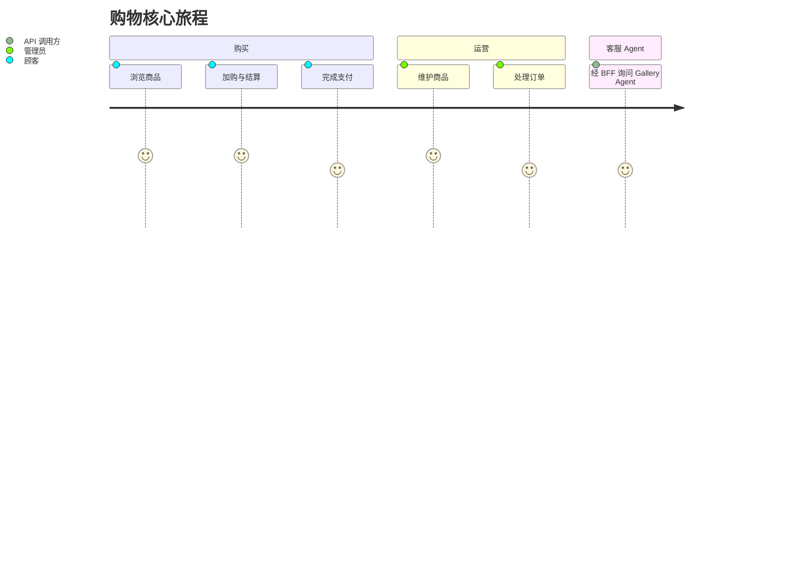

# 用户故事地图

> Jeff Patton 故事地图 + Mermaid journey + GWT（Epic 分文件）。  
> 本页为索引；正文与验收标准见 [user-stories/](./user-stories/)。

## 用户画像

| 角色 | 说明 |
|------|------|
| 顾客 | 浏览商品、下单与支付 |
| 管理员 | 管理商品、订单与用户 |
| API 调用方 | 经 Commerce BFF 调用 Explore AI Gallery |

## 旅程总览

## Backbone 故事地图

### 已实现

| 店面 | 订单支付 | 管理 | AI Agent BFF |
|------|----------|------|--------------|
| [US-01](./user-stories/E1-storefront.md#us-01-浏览商品列表) 浏览列表 | [US-04](./user-stories/E2-checkout.md#us-04-提交订单) 提交订单 | [US-07](./user-stories/E3-admin.md#us-07-维护商品) 维护商品 | [US-10](./user-stories/E4-ai-agent-bff.md#us-10-经-commerce-代理调用-gallery-agent) Gallery 代理 |
| [US-02](./user-stories/E1-storefront.md#us-02-查看商品详情并加购) 详情加购 | [US-05](./user-stories/E2-checkout.md#us-05-发起支付) 发起支付 | [US-08](./user-stories/E3-admin.md#us-08-处理订单) 处理订单 | |
| [US-03](./user-stories/E1-storefront.md#us-03-管理购物车) 购物车 | [US-06](./user-stories/E2-checkout.md#us-06-查看结账成功) 成功页 | [US-09](./user-stories/E3-admin.md#us-09-管理用户) 管理用户 | |

## Epic 索引

| Epic | 文件 | 故事 | 状态 |
|------|------|------|------|
| E1 店面 | [E1-storefront.md](./user-stories/E1-storefront.md) | US-01 – US-03 | 已实现 |
| E2 结账 | [E2-checkout.md](./user-stories/E2-checkout.md) | US-04 – US-06 | 已实现 |
| E3 管理 | [E3-admin.md](./user-stories/E3-admin.md) | US-07 – US-09 | 已实现 |
| E4 AI Agent BFF | [E4-ai-agent-bff.md](./user-stories/E4-ai-agent-bff.md) | US-10 | 已实现 |

## 参考

- [User Story Mapping — Jeff Patton](https://www.jpattonassociates.com/user-story-mapping/)
- [Domain Glossary](../Glossary.md)
